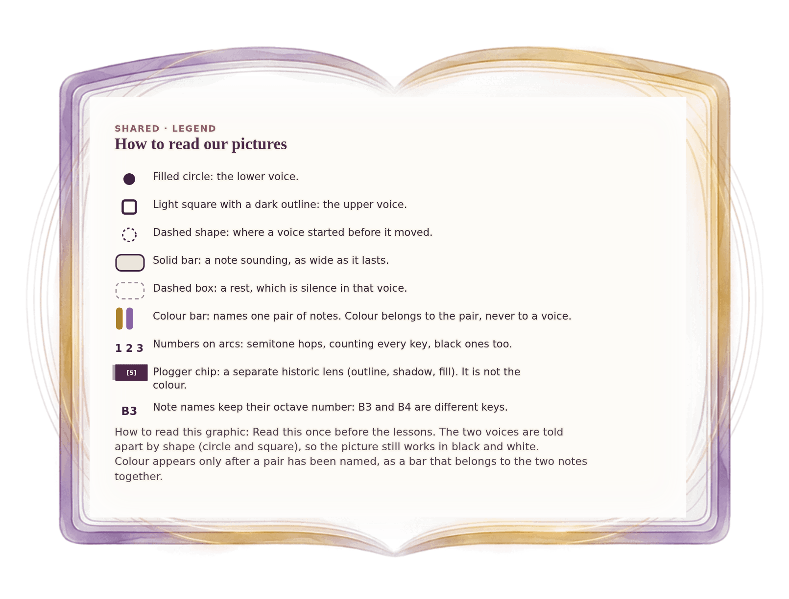

[⟵ A-11](A-11.desktop.md) · [**Index**](../README.md) · [H-01 ⟶](H-01.desktop.md)

# A-12 — How to read our pictures

**View:** **[ desktop ]** · [phone](A-12.phone.md) · [print](A-12.print.md)  
**Section:** Shared references · **Step(s):** H, 2A:5 · 10 of 50

### Zoom the real file
- 🔍 **[Open the full-size desktop PNG directly (browser pinch/zoom, 198 KB)](https://github.com/epaulson2/amf-app/raw/feat/ajourne-m08-week2-transparent-infographics-20261107/docs/m08/assets/A-12/A-12.desktop.png)**
- [GitHub image viewer page](../assets/A-12/A-12.desktop.png) · [Download / view editable SVG](../assets/A-12/A-12.desktop.svg) ([raw SVG](https://github.com/epaulson2/amf-app/raw/feat/ajourne-m08-week2-transparent-infographics-20261107/docs/m08/assets/A-12/A-12.desktop.svg))

*The picture above is the actual desktop PNG file (transparent; GitHub shows it on its own page colour). Click it to open the raw full-size file.*

**What it teaches:** The marks every Week 2 picture uses, including the rule that colour belongs to a pair of notes, not to a voice, and that shape tells the voices apart.

**How to read it:** Read this once before the lessons. The two voices are told apart by shape (circle and square), so the picture still works in black and white. Colour appears only after a pair has been named, as a bar that belongs to the two notes together.

All files: desktop [PNG](../assets/A-12/A-12.desktop.png) / [SVG](../assets/A-12/A-12.desktop.svg) · phone [PNG](../assets/A-12/A-12.phone.png) / [SVG](../assets/A-12/A-12.phone.svg) · print [PNG](../assets/A-12/A-12.print.png) / [SVG](../assets/A-12/A-12.print.svg) · [proof on cream and slate](../proof/A-12.proof.jpg)

[⟵ A-11](A-11.desktop.md) · [**Index**](../README.md) · [H-01 ⟶](H-01.desktop.md)
