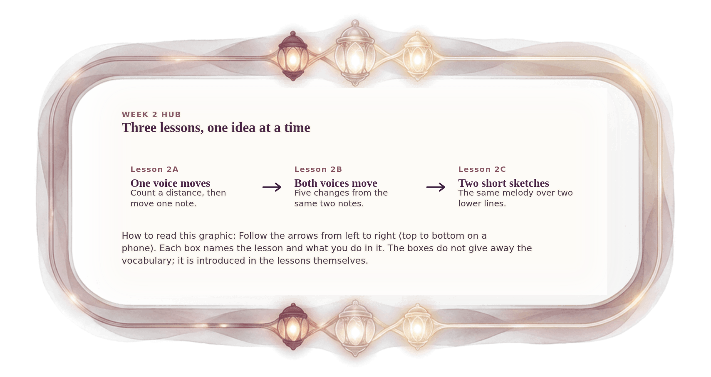

[⟵ A-12](A-12.desktop.md) · [**Index**](../README.md) · [H-02 ⟶](H-02.desktop.md)

# H-01 — The Week 2 path: three lessons

**View:** **[ desktop ]** · [phone](H-01.phone.md) · [print](H-01.print.md)  
**Section:** Week 2 hub · **Step(s):** H · 11 of 50

### Zoom the real file
- 🔍 **[Open the full-size desktop PNG directly (browser pinch/zoom, 198 KB)](https://github.com/epaulson2/amf-app/raw/feat/ajourne-m08-week2-transparent-infographics-20261107/docs/m08/assets/H-01/H-01.desktop.png)**
- [GitHub image viewer page](../assets/H-01/H-01.desktop.png) · [Download / view editable SVG](../assets/H-01/H-01.desktop.svg) ([raw SVG](https://github.com/epaulson2/amf-app/raw/feat/ajourne-m08-week2-transparent-infographics-20261107/docs/m08/assets/H-01/H-01.desktop.svg))

*The picture above is the actual desktop PNG file (transparent; GitHub shows it on its own page colour). Click it to open the raw full-size file.*

**What it teaches:** The order of the week: first one voice moves, then both voices move, then two short sketches put the ideas to work.

**How to read it:** Follow the arrows from left to right (top to bottom on a phone). Each box names the lesson and what you do in it. The boxes do not give away the vocabulary; it is introduced in the lessons themselves.

All files: desktop [PNG](../assets/H-01/H-01.desktop.png) / [SVG](../assets/H-01/H-01.desktop.svg) · phone [PNG](../assets/H-01/H-01.phone.png) / [SVG](../assets/H-01/H-01.phone.svg) · print [PNG](../assets/H-01/H-01.print.png) / [SVG](../assets/H-01/H-01.print.svg) · [proof on cream and slate](../proof/H-01.proof.jpg)

[⟵ A-12](A-12.desktop.md) · [**Index**](../README.md) · [H-02 ⟶](H-02.desktop.md)
