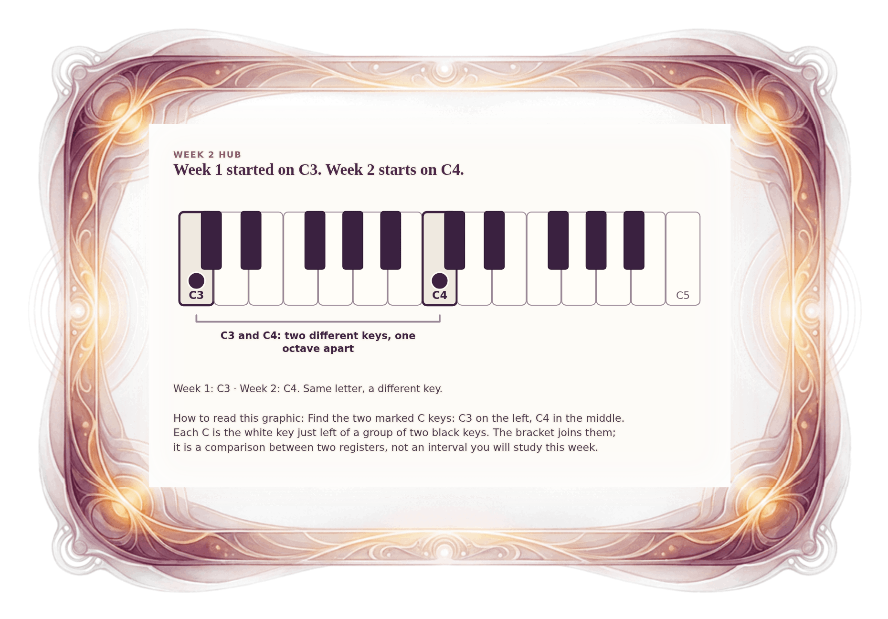

[⟵ H-01](H-01.desktop.md) · [**Index**](../README.md) · [H-03 ⟶](H-03.desktop.md)

# H-02 — Week 1 used C3; Week 2 starts at C4

**View:** **[ desktop ]** · [phone](H-02.phone.md) · [print](H-02.print.md)  
**Section:** Week 2 hub · **Step(s):** H, 2A:1 · 12 of 50

### Zoom the real file
- 🔍 **[Open the full-size desktop PNG directly (browser pinch/zoom, 406 KB)](https://github.com/epaulson2/amf-app/raw/feat/ajourne-m08-week2-transparent-infographics-20261107/docs/m08/assets/H-02/H-02.desktop.png)**
- [GitHub image viewer page](../assets/H-02/H-02.desktop.png) · [Download / view editable SVG](../assets/H-02/H-02.desktop.svg) ([raw SVG](https://github.com/epaulson2/amf-app/raw/feat/ajourne-m08-week2-transparent-infographics-20261107/docs/m08/assets/H-02/H-02.desktop.svg))

*The picture above is the actual desktop PNG file (transparent; GitHub shows it on its own page colour). Click it to open the raw full-size file.*

**What it teaches:** Week 1 started on C3 and Week 2 starts on C4. They are different keys, one octave apart, and not the same pitch.

**How to read it:** Find the two marked C keys: C3 on the left, C4 in the middle. Each C is the white key just left of a group of two black keys. The bracket joins them; it is a comparison between two registers, not an interval you will study this week.

All files: desktop [PNG](../assets/H-02/H-02.desktop.png) / [SVG](../assets/H-02/H-02.desktop.svg) · phone [PNG](../assets/H-02/H-02.phone.png) / [SVG](../assets/H-02/H-02.phone.svg) · print [PNG](../assets/H-02/H-02.print.png) / [SVG](../assets/H-02/H-02.print.svg) · [proof on cream and slate](../proof/H-02.proof.jpg)

[⟵ H-01](H-01.desktop.md) · [**Index**](../README.md) · [H-03 ⟶](H-03.desktop.md)
