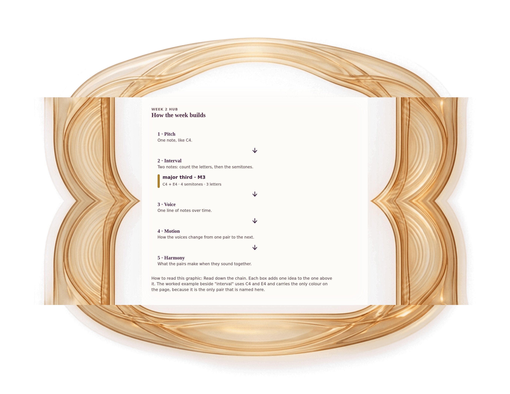

[⟵ H-02](H-02.desktop.md) · [**Index**](../README.md) · [H-04 ⟶](H-04.desktop.md)

# H-03 — From a note to harmony

**View:** **[ desktop ]** · [phone](H-03.phone.md) · [print](H-03.print.md)  
**Section:** Week 2 hub · **Step(s):** H · 13 of 50

### Zoom the real file
- 🔍 **[Open the full-size desktop PNG directly (browser pinch/zoom, 826 KB)](https://github.com/epaulson2/amf-app/raw/feat/ajourne-m08-week2-transparent-infographics-20261107/docs/m08/assets/H-03/H-03.desktop.png)**
- [GitHub image viewer page](../assets/H-03/H-03.desktop.png) · [Download / view editable SVG](../assets/H-03/H-03.desktop.svg) ([raw SVG](https://github.com/epaulson2/amf-app/raw/feat/ajourne-m08-week2-transparent-infographics-20261107/docs/m08/assets/H-03/H-03.desktop.svg))

*The picture above is the actual desktop PNG file (transparent; GitHub shows it on its own page colour). Click it to open the raw full-size file.*

**What it teaches:** How the week's ideas build on each other: a note, two notes (an interval), a line of notes (a voice), a change between pairs (motion), and what the pairs make together (harmony).

**How to read it:** Read down the chain. Each box adds one idea to the one above it. The worked example beside "interval" uses C4 and E4 and carries the only colour on the page, because it is the only pair that is named here.

All files: desktop [PNG](../assets/H-03/H-03.desktop.png) / [SVG](../assets/H-03/H-03.desktop.svg) · phone [PNG](../assets/H-03/H-03.phone.png) / [SVG](../assets/H-03/H-03.phone.svg) · print [PNG](../assets/H-03/H-03.print.png) / [SVG](../assets/H-03/H-03.print.svg) · [proof on cream and slate](../proof/H-03.proof.jpg)

[⟵ H-02](H-02.desktop.md) · [**Index**](../README.md) · [H-04 ⟶](H-04.desktop.md)
