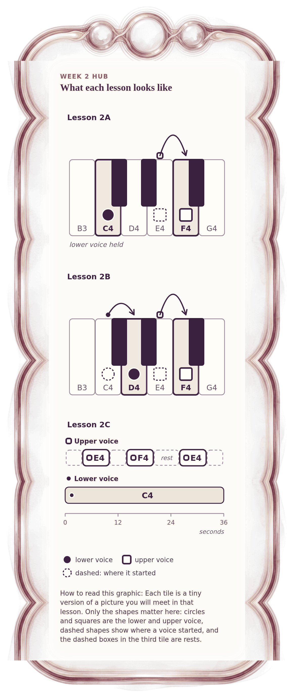

[⟵ H-03](H-03.phone.md) · [**Index**](../README.md) · [2A-01 ⟶](2A-01.phone.md)

# H-04 — Three lessons in miniature

**View:** [desktop](H-04.desktop.md) · **[ phone ]** · [print](H-04.print.md)  
**Section:** Week 2 hub · **Step(s):** H · 14 of 50

### Zoom the real file
- 🔍 **[Open the full-size phone PNG directly (browser pinch/zoom, 404 KB)](https://github.com/epaulson2/amf-app/raw/feat/ajourne-m08-week2-transparent-infographics-20261107/docs/m08/assets/H-04/H-04.phone.png)**
- [GitHub image viewer page](../assets/H-04/H-04.phone.png) · [Download / view editable SVG](../assets/H-04/H-04.phone.svg) ([raw SVG](https://github.com/epaulson2/amf-app/raw/feat/ajourne-m08-week2-transparent-infographics-20261107/docs/m08/assets/H-04/H-04.phone.svg))

*The picture above is the actual phone PNG file (transparent; GitHub shows it on its own page colour). Click it to open the raw full-size file.*

**What it teaches:** A glimpse of what each lesson looks like on the page: one moving voice, two moving voices, and a timeline with rests.

**How to read it:** Each tile is a tiny version of a picture you will meet in that lesson. Only the shapes matter here: circles and squares are the lower and upper voice, dashed shapes show where a voice started, and the dashed boxes in the third tile are rests.

All files: desktop [PNG](../assets/H-04/H-04.desktop.png) / [SVG](../assets/H-04/H-04.desktop.svg) · phone [PNG](../assets/H-04/H-04.phone.png) / [SVG](../assets/H-04/H-04.phone.svg) · print [PNG](../assets/H-04/H-04.print.png) / [SVG](../assets/H-04/H-04.print.svg) · [proof on cream and slate](../proof/H-04.proof.jpg)

[⟵ H-03](H-03.phone.md) · [**Index**](../README.md) · [2A-01 ⟶](2A-01.phone.md)
