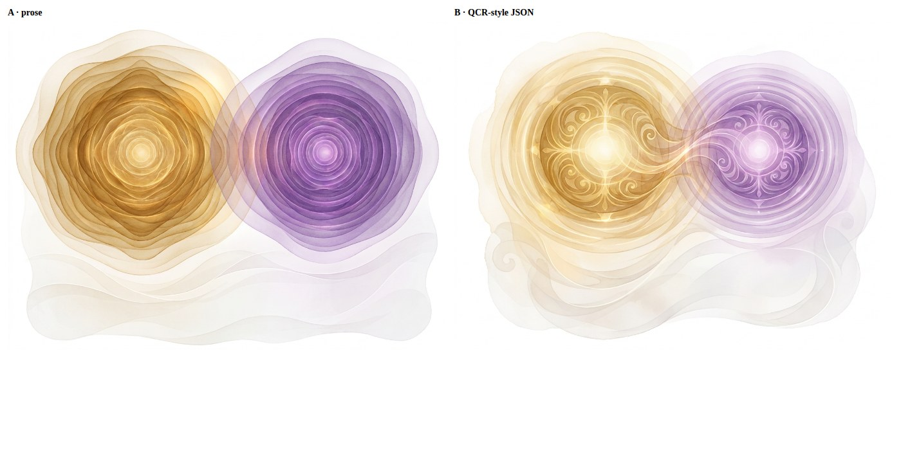
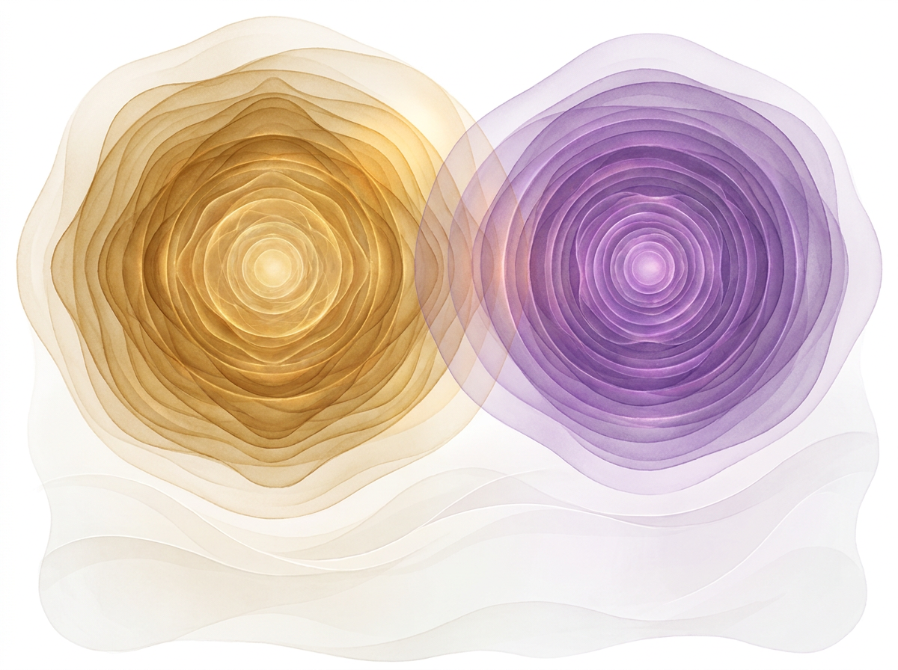
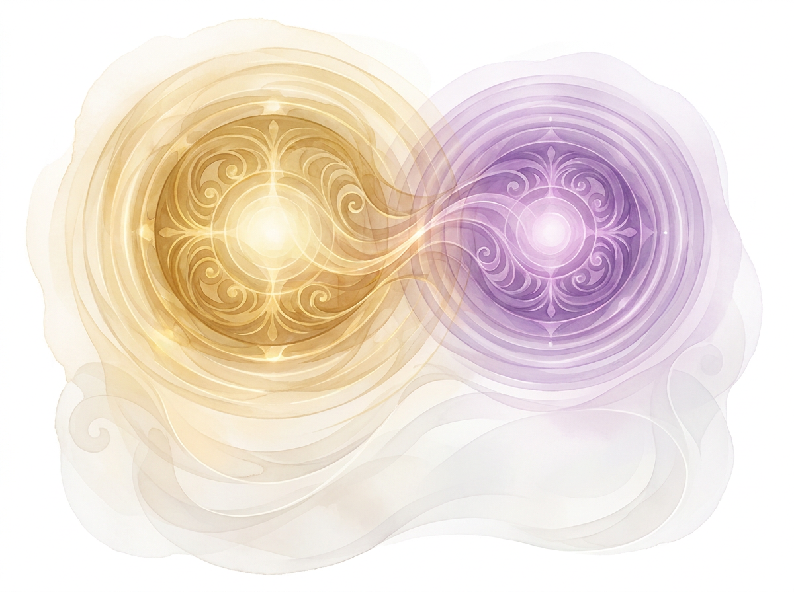
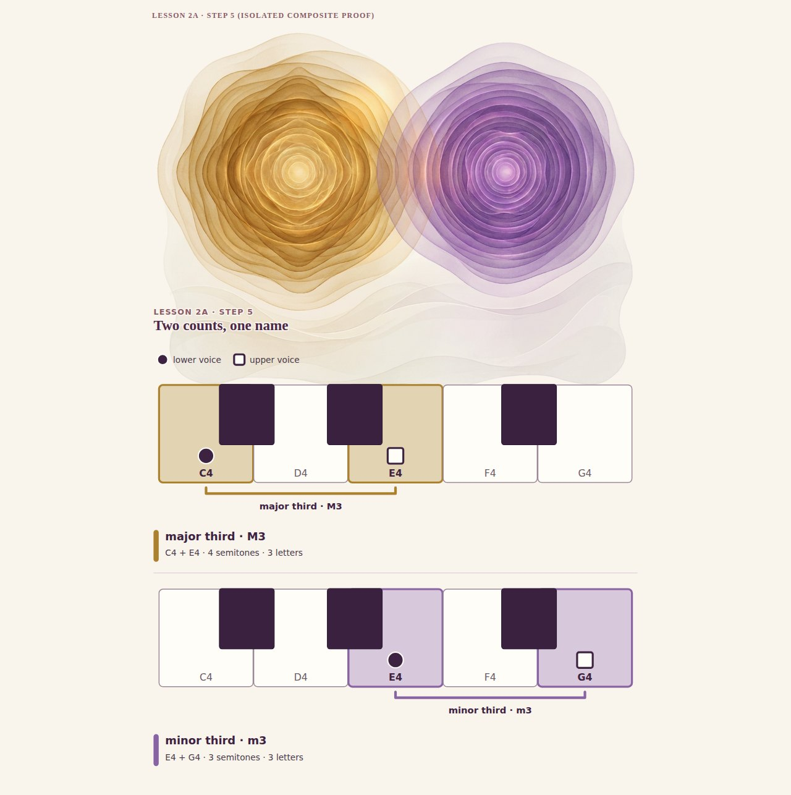
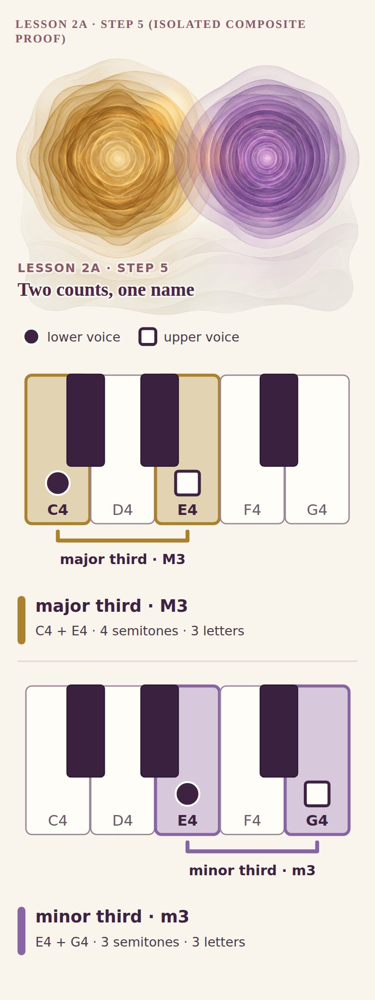
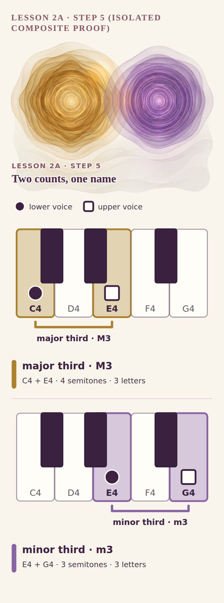
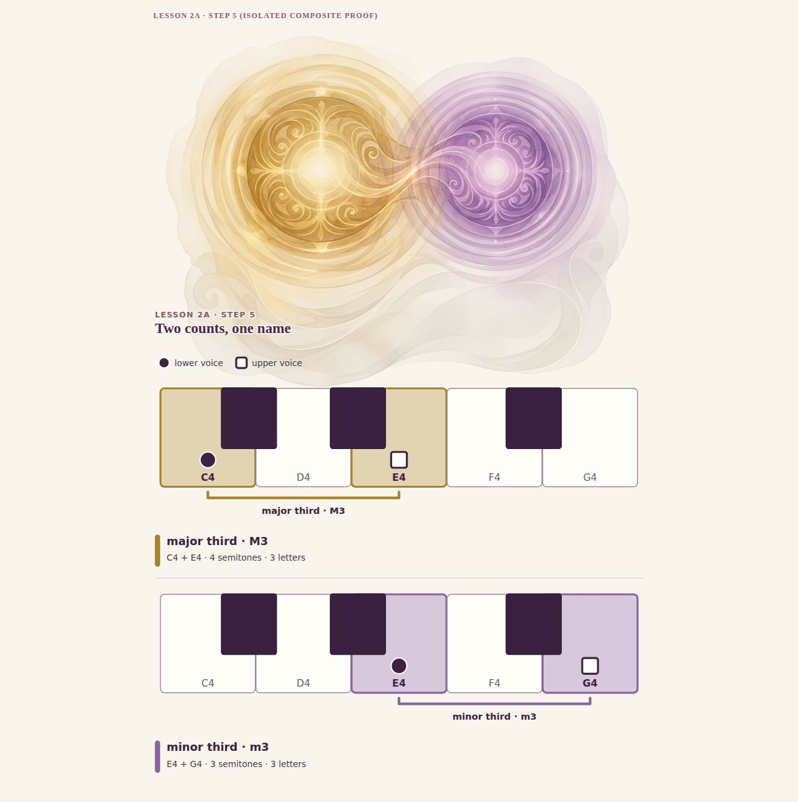
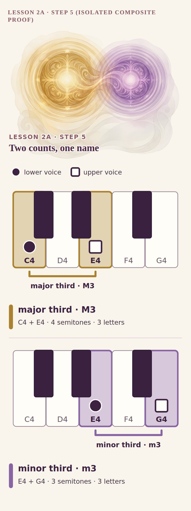
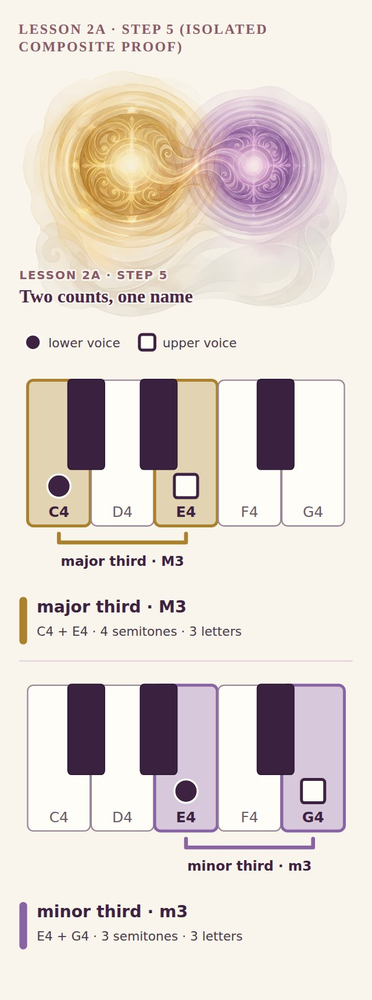
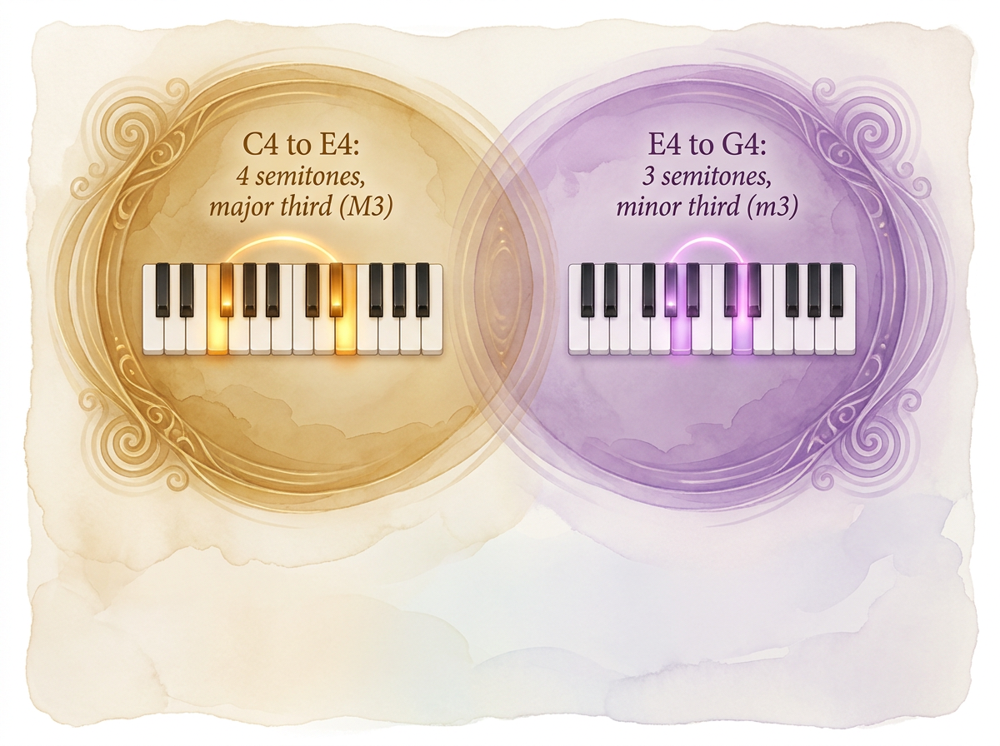

# Nano Banana JSON-prompt pilot: does it reach the approved Ajourné richness?

**Branch:** `experiment/ajourne-nb-json-style-pilot-20261107` (from M07 `b409576`). Test only: no live code, no site change, no 50-asset production, no deploy.
**Result in one line:** with the same model, same reference and same content, **both arms produced rich translucent watercolor/glass art, and the QCR JSON arm (B) was clearly the stronger and more on-concept; image generation still must stay art-only (arm C proves it).**

## What was run (3 chargeable calls, $0.4110 of the $2.00 cap)

| | Arm | Prompt | Model / settings | Cost | Output |
|---|---|---|---|---|---|
| A | Control: detailed matched **prose** | [A_prose.txt](prompts/A_prose.txt) | `google/gemini-3-pro-image` (Nano Banana Pro) via `POST /api/v1/images`, 4:3, 2K | $0.1363 | [raw/A.png](raw/A.png) |
| B | **QCR-style JSON** (`reference_image_policy`, `identity_lock` with `source:"image"`, `changeable` with `source:"text"`, `forbidden_changes`, `quality_checks`), serialized into the prompt string | [B_json.json](prompts/B_json.json) | identical | $0.1374 | [raw/B.png](raw/B.png) |
| C | Stress test: JSON asking for the **full infographic** with exact notes | [C_json_infographic.json](prompts/C_json_infographic.json) | identical | $0.1374 | [raw/C.png](raw/C.png) |

- Model verified live in the OpenRouter catalog before calling (input: image+text; output: image; $0.00012 per image-output token). The Images API accepted `input_references` with the actual PNG bytes (data URL), not a path in prose.
- Reference (style only): `APPROVED_ART_DIRECTION_REFERENCE.png`, sha256 `a5346fa8…e130ab`. It is not in this repo.
- **`THUMBNAIL_TRANSFER_FAILED`:** the ChatGPT-board thumbnail base64 on the docs branch is truncated (3514 characters, not decodable to the expected SHA `6069a645…`). It was not used; the canonical reference was used for **all** arms. I did not have, and did not claim, the full-resolution ChatGPT art.
- Everything else (prompt hashes, output hashes, costs, scores): [`prompts/qa.json`](prompts/qa.json) and [`ledger.json`](ledger.json). No key was logged. Each arm ran once (n = 1), so nothing here shows repeatability.

## Raw A vs B (actual generated pixels)

| A · prose | B · JSON |
|---|---|
|  |  |

## Composited proof (art + the exact native M07 figure 2A-04)

White background converted to alpha ([alpha.mjs](tools/alpha.mjs)), placed behind the native C4–E4 / E4–G4 keyboards, which carry all facts. Isolated composite, not the live site. (The art's lower area overlaps the heading slightly: placement is a proof, not final layout.)

| | 1280 | 390 | 320 |
|---|---|---|---|
| **A** |  |  |  |
| **B** |  |  |  |

Transparent art: [A.alpha.png](composite/A.alpha.png), [B.alpha.png](composite/B.alpha.png).

## Optional stress test C: asked to draw the exact notation

The text came out right ("C4 to E4: 4 semitones, major third (M3)", "E4 to G4: 3 semitones, minor third (m3)"), but the keyboards are **not verified facts**: neither keyboard shows a three-letter span between its lit keys (the left pair sits several white keys apart, the right pair only about two), the key counts and registers are decorative, and the card/frame is exactly the poster look the brief forbids. **C fails the factual gate.** This confirms: raster text and keys may look right and still be wrong, so native SVG must own every note, key and number.

## Four-criteria read (1 to 5, one reviewer, you decide)

| | Visual richness | Semantic readability (two related fields) | Factual reliability (art only, no facts) | Page integration (alpha, calm lower area) |
|---|---|---|---|---|
| A prose | 4 | 3 | 5 | 4 |
| B JSON | **5** | **4** | 5 | 4 |
| C JSON infographic | 4 | 2 | **1** | 1 |

- **B vs A:** B's two fields differ in size (wider left, narrower right) and share ornament grammar (symmetric filigree rosettes, luminous cores) joined by a flowing bridge, which reads as a *relationship*. A is lush layered ripples, but its two discs are nearly the same size, so the wide-versus-narrow idea is weak.
- **Specific deviations:** both arms followed no-text and no-keys. Amber and violet are close to the canonical `#AB812D` / `#8964A4` but are model colours, not tokens. The lower area is calm but not empty. The B bridge could be read as implying a link or measure, which the art must not claim.
- **Honest limit:** JSON is a prompt convention, not an enforced constraint. One run each cannot show that JSON beats prose in general; here it produced the better picture.

## Conservative recommendation

1. The richness gap you saw in the flat M07 pastel washes is closable: Nano Banana Pro with the approved reference produces art at the ChatGPT-board calibre of material and depth.
2. If you want to proceed, use the **B method** for a small number of art-only layers behind native figures (one per lesson opener or concept), and a second variation round before locking anything.
3. Keep every note, key, number and label native SVG. Never use C-style output.
4. This is a test, not a style lock or a production go-ahead. Nothing here is integrated; the 50 M07 graphics are unchanged.

Spent: **$0.4110** (3 calls). No top-ups, no further calls made.
