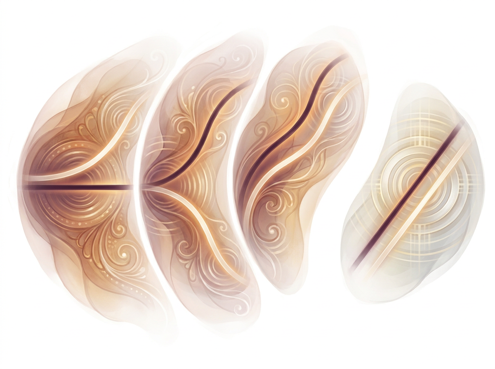
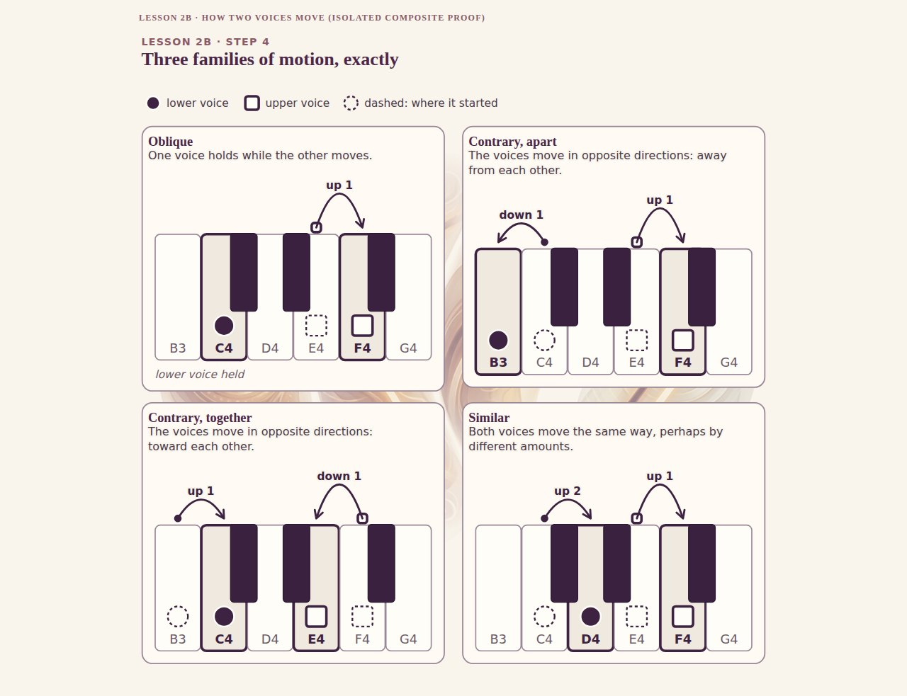
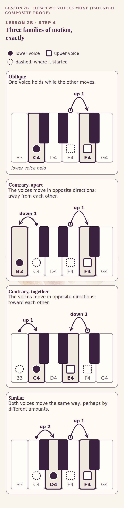
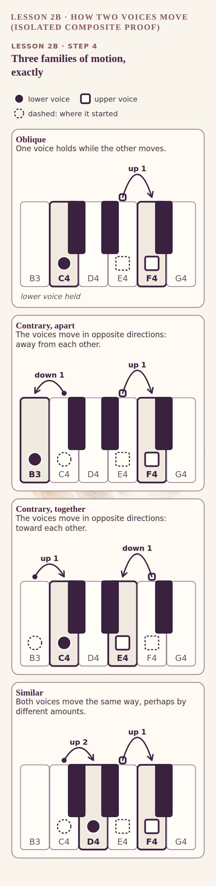
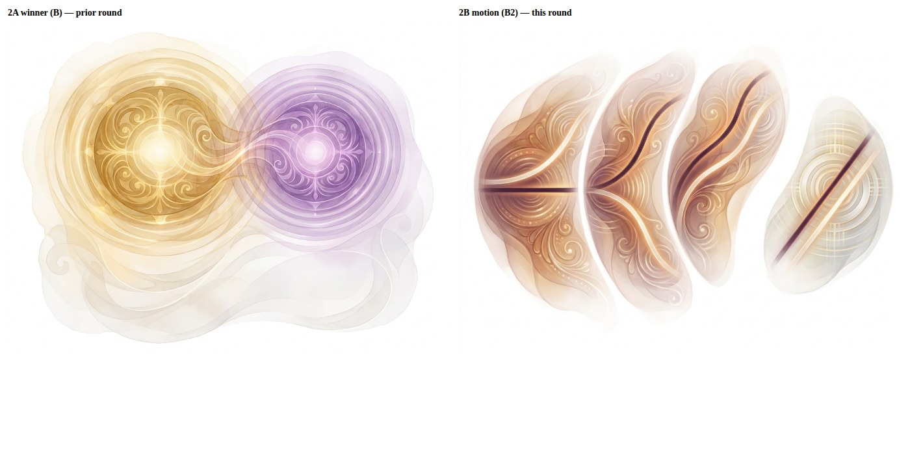

# Round 2 — Lesson 2B "How Two Voices Move": one JSON-method art image

Test only. No M07 change, no site/Palette change, no bulk. Branch `experiment/ajourne-nb-json-motion-pilot-20261107` (from the round-1 pilot).

## Run facts
| | |
|---|---|
| Model / endpoint | `google/gemini-3-pro-image` (Nano Banana Pro), `POST /api/v1/images`; catalog re-checked today: image output $0.00012/token |
| Call | 1 chargeable call (cap 1), 4:3, 2K, `input_references` = real reference bytes (2,686,367 B, sha256 `a5346fa879c0480a802fa7a2364ba16b39e7a7a1ccc35f37010cffd4a8e130ab`) |
| Logged cost | **$0.137956** (cap $0.50), 33.7 s. No retries, no second model |
| Output | `raw/B2.png` sha256 `866b5ffa1cf5b96b10b02f77434e8a8de2358092f5505c18532a76d111d8a74c` (1,111,457 B) |
| Prompt | `prompts/B2_motion.json` sha256 `6fb977274bc8dc535c7302b62e64f4f456a8c34e04d949be052a85306d408d4a` (exact text below). Same B structure as round 1: `reference_image_policy`, image-locked medium/lighting/composition/background/craftsmanship, text-only `changeable`, `forbidden_changes`, `quality_checks` |
| Ledger | `ledger.json` |

The private reference is not in the repo.

## The image (actual pixels)


Alpha extraction (white to transparency): `composite/B2.alpha.png`.

## Hybrid with the native 2B-02 diagram (M07 SVG, unmodified)
Art sits behind at 55% opacity. 1280 / 390 / 320:





## Comparison with the 2A winner


## Honest read (single reviewer, n = 1, scores are mine)
- **Style carried over: yes.** Same translucent layered watercolor/glass, filigree, warm ivory/plum, soft organic edges, no text/keys/arrows/note names, no interval colour on the strands. Strands are neutral plum-umber and pearl-ivory.
- **Zone 2 (contrary) and zone 3 (similar) read well.** Zone 3 shows both strands rising with the pale one travelling farther.
- **Zone 4 (strict parallel) is clearly separate**: detached, cooler, grid-like ornament, two equal-spaced rails. This worked as requested.
- **Zone 1 (oblique) is weak.** The level dark strand has a pale strand fanning both up and down from it, which reads as a mirrored contrary fan rather than "one stays, one moves". It would mislead if used alone.
- **Quiet label zones were not honoured.** The four fields fill most of the frame. Little reserved space exists beneath or above them.
- **Hybrid fit is poor.** 2B-02 has four opaque keyboard panels (oblique, contrary apart, contrary together, similar) and no strict-parallel panel. The art's four zones do not map one-to-one, so behind the panels the art is mostly hidden. Usable as a lesson-header band or per-concept backdrops, not as a full-figure backdrop.
- Fourth zone is a convention label to add natively; the art itself carries no claim.

## Recommendation (founder decides)
The method holds up for art-only motion layers, but this single image is not ready to lock as-is. Before any bulk: one separate generation per concept (so each zone is its own asset, avoiding the layout mismatch), with oblique specified as "one strand level, one strand departs on one side only". Facts stay native SVG.

## Exact prompt (`prompts/B2_motion.json`)
```json
{
 "task": "generate_original_teaching_concept_art",
 "schema": "ajourne_nano_banana_qcr_style_lock/1",
 "reference_image_policy": {
  "used": true,
  "roles": {
   "ref1": "lock art material, light, transparency, tactile watercolor/glass craft and warm luminous depth"
  },
  "instructions": [
   "If an attribute allows image as source and no text value is provided, copy it from the reference",
   "Inference or stylistic guessing is forbidden where the image is the source"
  ],
  "copy_concept_not_pixels": true,
  "reference_is_style_only": "notes, key positions, labels and any text in the reference are not facts and must not be reproduced"
 },
 "identity_lock": {
  "artistic_medium": {
   "source": "image",
   "locked": true,
   "meaning": "translucent layered watercolor and glass, painterly grain, intricate spatial depth"
  },
  "lighting": {
   "source": "image",
   "locked": true,
   "meaning": "soft internal amber luminance, restrained highlights, tactile shadowing"
  },
  "composition_quality": {
   "source": "image",
   "locked": true,
   "meaning": "complex but airy overlapping fields, delicate concentric ripples with a knowledge purpose"
  },
  "background_integration": {
   "source": "image",
   "locked": true,
   "meaning": "soft organic edges, no rectangular wallpaper or pasted card"
  },
  "craftsmanship_floor": {
   "source": "image",
   "locked": true,
   "meaning": "rich integrated concept-board calibre, not generic simple flat vector"
  }
 },
 "changeable": {
  "subject": {
   "source": "text",
   "value": "Week 2 Lesson 2B 'How Two Voices Move': two independent voice paths travelling together, shown as four distinct teaching zones of motion"
  },
  "visual_structure": {
   "source": "text",
   "value": "Each zone shows the SAME pair of independent luminous strands, one deeper plum-umber strand and one paler pearl-ivory strand, travelling left to right through its own soft-edged luminous field. Zone 1 (oblique): one strand lies calm and level while the other lifts or falls away alone. Zone 2 (contrary): the two strands diverge, one rising while the other descends, opening like a gentle crossing-free fan. Zone 3 (similar): both strands travel the same direction, both rising, but the second travels visibly farther than the first so their gap changes. Zone 4 (strict parallel): both strands travel the same direction by exactly equal amounts, remaining evenly spaced like twin rails; this zone is set apart by a wider breathing gap and a distinctly cooler, quieter, more geometric ornament grammar so it reads as a separate teaching convention, not one of the first three. Arrange zones 1-3 as a flowing arc of related fields and zone 4 as a gently detached fourth field. Delicate filigree and concentric ripples share one ornament grammar across zones; every zone clearly shows two independent paths."
  },
  "accent_identity": {
   "source": "text",
   "value": "strands use ONLY neutral warm plum-umber and pearl-ivory with soft gold-white glow; absolutely NO amber #AB812D vs violet #8964A4 pairing, no interval colours, no rainbow coding. A strand is a voice; hue never encodes an interval or a voice identity."
  },
  "negative_space": {
   "source": "text",
   "value": "reserve calm, lighter, uncluttered quiet zones beneath each of the four fields and across the top for later exact native labels; keep the fields from touching each other's quiet zones"
  },
  "background": {
   "source": "text",
   "value": "isolated on a pure flat white background (#FFFFFF), organic soft silhouette edges, nothing touching the frame edges, warm ivory and plum atmosphere inside the fields"
  }
 },
 "forbidden_changes": [
  "changing the reference's warm organic art-material treatment to flat schematic vector",
  "generic decorative swirls without two discernible independent paths per zone",
  "sharp rectangular background edges, posters, cards, panels, watermarks, UI controls",
  "any text, letters, numerals, arrows, arrowheads, piano keys, notation, staff lines, time axes, note names, interval names or source claims",
  "colouring either strand with an interval identity colour",
  "merging strict parallel into the other three zones or making all zones look alike"
 ],
 "output": {
  "format": "image",
  "aspect_ratio": "4:3",
  "intended_use": "isolated painterly conceptual layer for deterministic native factual overlays"
 },
 "quality_checks": {
  "visual_fidelity": "match richness, layering, warmth and quality of the approved reference and the prior winning JSON result",
  "semantic_clarity": "four distinguishable motion relationships, each with two independent strands; zone 4 visibly separate",
  "compositing": "suitable for overlay with exact native 2B-02 labels and diagrams",
  "technical_validity": "no generated note, key, number, arrow or label facts"
 }
}
```
