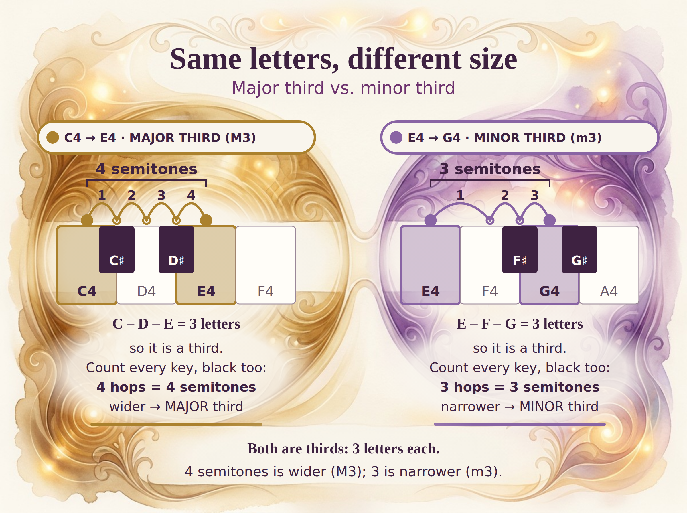
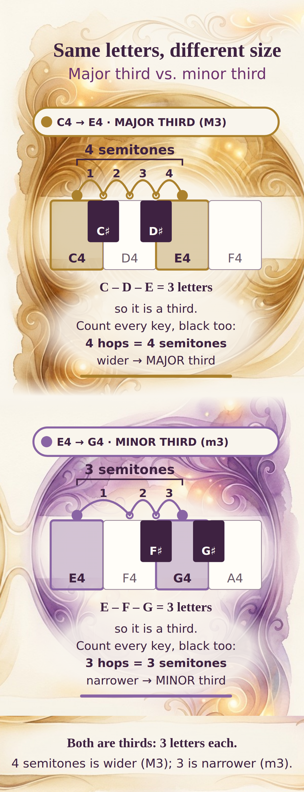

# Lesson 2A "Same Letters, Different Size" — finished composite infographic (test, not bulk)

**Status: PROTOTYPE FOR FOUNDER ASSESSMENT. Not claimed ready.** Test branch only: no M07 edits, no site/Palette change, no deploy, no bulk.

## (a) Finished composite infographic — desktop (2400×1792)


## (b) Final phone preview (390 css wide, 1170×3042 px)


Phone is a reflow of the same painting: the left and right halves of the model art are cropped and stacked, with the same native overlay text/keys re-laid over each half. Print variant: **not made** (would reuse the desktop SVG on a lighter art wash; not practical in this single-call budget).

## (c) Components (one composition, built from these)
| Component | File |
|---|---|
| Model art (painted surface, JPEG 1200 px) | `source/art.B3.jpg`, raw `raw/B3.png` (sha256 `d6ee4dbfdfccfa47204e7eb95303903920d689fd99367cfc2bc4cbdaf3b66d99`) |
| Editable native desktop SVG (art embedded + exact native layer) | `source/infographic.desktop.svg` |
| Editable native phone SVG | `source/infographic.phone.svg` |
| Generator (colours via `identityHex()` import from M07 kit, i.e. `INTERVAL_IDENTITY_COLORS_V1`) | `tools/build.mts`, render `tools/render.py` |

Everything legible is native: title, pills, keys, note names, hop arcs, counts, explanations. The model contributed only the luminous watercolor/glass surface and ornament. Native elements sit inside the painted clearings with feathered ivory washes, not in a card.

## (d) Prompt JSON, model, cost
- Model `google/gemini-3-pro-image` (Nano Banana Pro) via OpenRouter `POST /api/v1/images`, 4:3, 2K, real reference bytes (2,686,367 B, sha256 `a5346fa879c0480a802fa7a2364ba16b39e7a7a1ccc35f37010cffd4a8e130ab`); not in repo.
- **1 chargeable call, cost $0.13803** (cap $0.50), 29.3 s, no retries. `ledger.json`.
- `prompts/B3_infographic.json` sha256 `2a92cb5e1e83a0b05f3b9e35a162c818fb2371944f1a739032c66c6c07b86652`. Same winning B structure; model is art director of the surface, with named clearings (title, two keyboard bands, two text areas, summary).

<details><summary>Exact prompt JSON</summary>

```json
{
 "task": "art_direct_information_bearing_teaching_infographic_surface",
 "schema": "ajourne_nano_banana_qcr_style_lock/1",
 "reference_image_policy": {
  "used": true,
  "roles": {
   "ref1": "lock art material, light, transparency, tactile watercolor/glass craft and warm luminous depth"
  },
  "instructions": [
   "If an attribute allows image as source and no text value is provided, copy it from the reference",
   "Inference or stylistic guessing is forbidden where the image is the source",
   "this image is the painted SURFACE of a finished infographic; exact notation will be overlaid natively on its clearings, so the clearings must be real, generously sized and calm"
  ],
  "copy_concept_not_pixels": true,
  "reference_is_style_only": "notes, key positions, labels and any text in the reference are not facts and must not be reproduced"
 },
 "identity_lock": {
  "artistic_medium": {
   "source": "image",
   "locked": true,
   "meaning": "translucent layered watercolor and glass, painterly grain, intricate spatial depth"
  },
  "lighting": {
   "source": "image",
   "locked": true,
   "meaning": "soft internal amber luminance, restrained highlights, tactile shadowing"
  },
  "composition_quality": {
   "source": "image",
   "locked": true,
   "meaning": "complex but airy overlapping fields, delicate concentric ripples with a knowledge purpose"
  },
  "background_integration": {
   "source": "image",
   "locked": true,
   "meaning": "soft organic edges, no rectangular wallpaper or pasted card"
  },
  "craftsmanship_floor": {
   "source": "image",
   "locked": true,
   "meaning": "rich integrated concept-board calibre, not generic simple flat vector"
  }
 },
 "changeable": {
  "subject": {
   "source": "text",
   "value": "Week 2 Lesson 2A infographic surface: the same interval number (a third) in two different sizes, shown as a left panel and a right panel of one single painting"
  },
  "visual_structure": {
   "source": "text",
   "value": "One unified 4:3 painting on a warm ivory watercolor-paper ground, no outer frame or card. Top 14%: a calm pale-ivory title clearing with delicate ornament above it. Below it two large luminous translucent glass-and-watercolor fields side by side, LEFT field a little wider and tinted antique amber (#AB812D), RIGHT field narrower and tinted orchid violet (#8964A4), joined by a gentle ivory bridge in the middle so they read as one family. Inside each field, leave a large calm wide pale-ivory clearing across its middle (about 30% of total height) for a keyboard diagram, and a second calm pale clearing across the lower part of each field (about 25% of height) for short explanatory text. Rich purposeful filigree, concentric ripples, fine glass layering and glowing edges live in the margins, corners and around the clearings, flowing into the content areas rather than boxing them. Across the very bottom, one calm wide pale clearing for a single summary sentence. Both fields share the same ornament grammar; left and right halves should each work as a self-contained portrait panel if cropped at the vertical centre."
  },
  "accent_identity": {
   "source": "text",
   "value": "left field antique amber #AB812D, right field orchid violet #8964A4, as soft washes and glows; these identify the two interval relationships only"
  },
  "negative_space": {
   "source": "text",
   "value": "the clearings must be quiet, light, low-contrast ivory with only faint texture, so dark plum text and piano-key drawings overlaid later stay perfectly legible"
  },
  "background": {
   "source": "text",
   "value": "full-bleed warm ivory (#F9F5ED) watercolor paper with soft organic painted edges fading into the ivory; no hard rectangle, no border line"
  }
 },
 "forbidden_changes": [
  "changing the reference's warm organic art-material treatment to flat schematic vector",
  "generic decorative swirls without a left/right pair relationship",
  "hard rectangular boxes, poster frames, cards, borders, watermarks, UI controls",
  "any text, letters, numerals, piano keys, notation, staff lines, arrows, labels or musical claims",
  "ornament, texture or dark colour inside the reserved clearings",
  "treating interval colour as a property of sound or of a voice"
 ],
 "output": {
  "format": "image",
  "aspect_ratio": "4:3",
  "intended_use": "painted surface of a finished infographic; native exact text, keys and arcs are overlaid on the clearings"
 },
 "quality_checks": {
  "visual_fidelity": "match richness, layering, warmth and quality of the approved reference",
  "semantic_clarity": "two related fields, left wider than right, clearly amber vs violet",
  "compositing": "six clearly usable calm clearings (title, 2 keyboard, 2 text, summary) with ornament integrated around them",
  "technical_validity": "no generated note, key, numeral or label facts"
 }
}
```
</details>

## (e) Quick fact-accuracy audit (native layer)
| Claim in graphic | Check | Result |
|---|---|---|
| Left C4→E4, letters C–D–E | 3 letters | OK |
| Left hops | C, C♯, D, D♯, E = 4 successive adjacent keys incl. black | OK (4) |
| Left colour | `identityHex(4)` = M3 | `#AB812D` OK |
| Right E4→G4, letters E–F–G | 3 letters | OK |
| Right hops | E, F, F♯, G = 3 (E→F has no black key between) | OK (3) |
| Right colour | `identityHex(3)` = m3 | `#8964A4` OK |
| Note names | C4/E4 and E4/G4 (not C4/E♭4) | OK |
| Keyboard geometry | whites C D E F and E F G A; blacks C♯ D♯ and F♯ G♯ at the correct boundaries; no black between E–F | OK |
| Colour semantics | hue only on the interval (pill, key highlight, hops, rule); no voices drawn | OK |
| No model-generated facts | art contains no text/keys/numerals (visually checked) | OK |

Not machine-verified; visual review only. Hop-arc spacing is truthful, not uniform: the E→F arc is wider than the black-key hops.

## Honest assessment (single reviewer)
- **Works:** it reads as one painted teaching page; information is the design; counts, letters and explanations are legible; keys exact.
- **Weak / provisional:** art circles are equal size, so "wider vs narrower" is carried by the numbers, not the painting. Hop labels 1–4 sit close to the total bracket. Pill text is tight in the pill. On phone, the right-panel crop and summary strip have faint seams. Fonts are system fonts, not final brand type. White keys are opaque ivory, not glass. Not a match of the original ChatGPT boards' density in every region.
- n = 1; scores are mine.

STOP for founder assessment.
