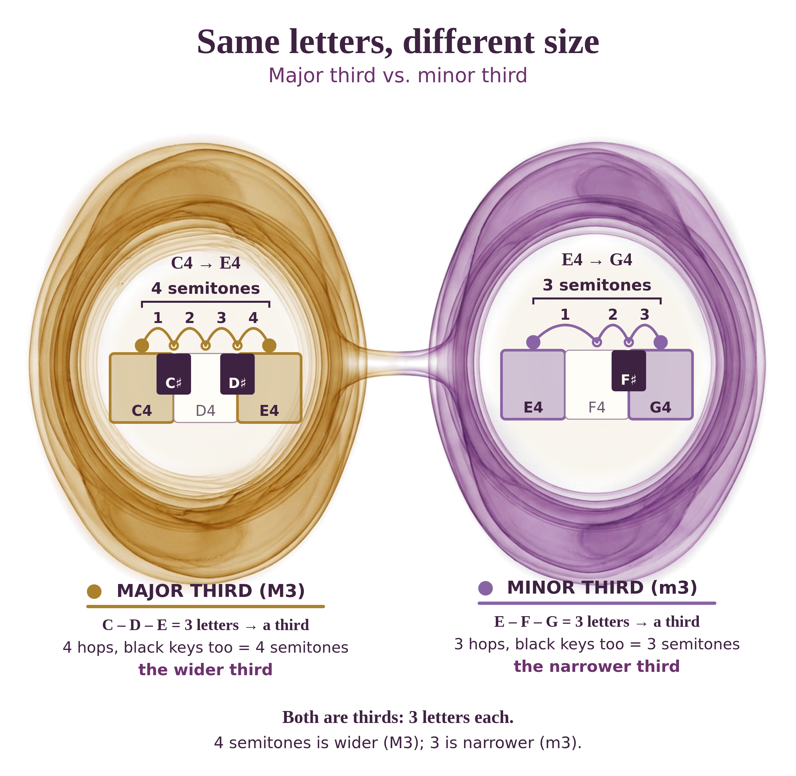
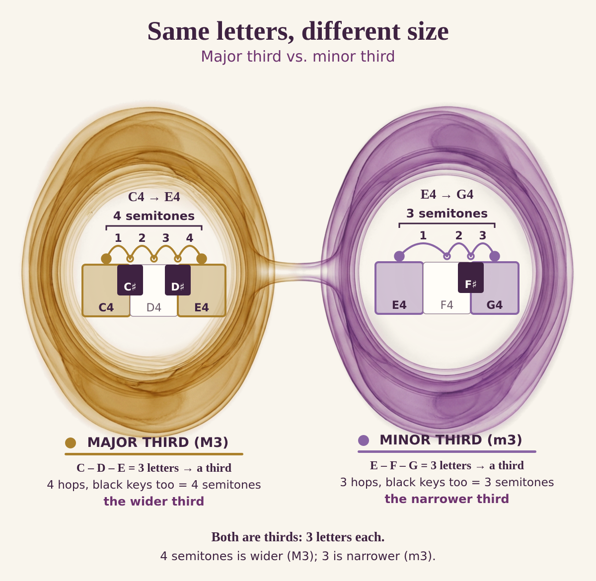
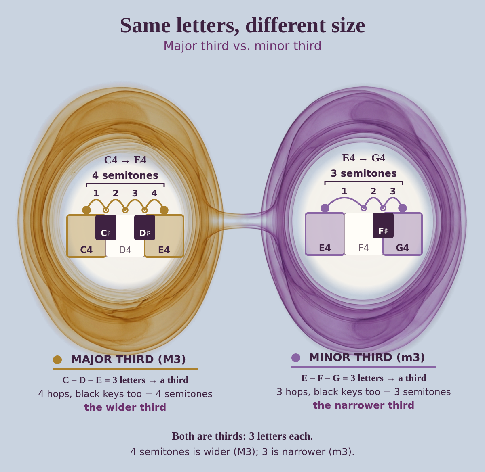
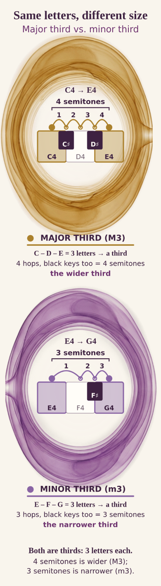
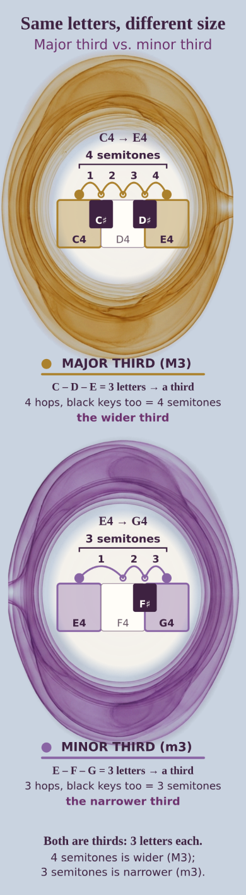

# Round 4 — Lesson 2A "Major Third vs Minor Third": transparent standalone infographic (one test)

**Status: PROTOTYPE for founder assessment, not ready.** Isolated branch; no M07, site, Palette, deploy or bulk. No page background is baked in anywhere: the outside is true alpha.

## Finished transparent foreground (desktop, 2400×2340 PNG with alpha)
Shown here over the GitHub page colour; the file itself has no background.



## Same file over two plain colours (proof)
| Cream `#F9F5ED` | Slate `#C9D3E0` |
|---|---|
|  |  |

## Phone (390 css, 1170×4248 PNG with alpha) over the same two colours
| Cream | Slate |
|---|---|
|  |  |

## Components
- Model art, raw on white: `raw/B4.png` (sha256 `0c2483b8506c6372c14b06bbf68a97b1c13122ebac266c53234cab745ed8b5ca`); extracted true-alpha art `source/art.alpha.png`; phone variant with the bridge cleared `source/art.alpha.nobridge.png`.
- Editable native SVGs (art embedded + exact native layer, no background rect): `source/infographic.desktop.svg`, `source/infographic.phone.svg`.
- Tools: `tools/run.py` (single call, cap enforced), `tools/alpha.mjs`, `tools/build.mts` (colours from `identityHex()`), `tools/render.py`, `tools/qa.mjs`.

## Approach
Transparent output was not requested from the provider; the prompt asks for isolated objects on pure white and the PNG was converted to alpha by unmultiplying against white, with a 3.5% haze floor. The model supplied only two glass-and-watercolor halo medallions (amber left, violet right) joined by a glass bridge, with quiet milky interiors. Title, keys, note names, hop arcs, counts and all explanations are native SVG, set on soft ivory glass plates inside each halo (part of the object, so text stays legible on any light page colour).

## Cost and model
- `google/gemini-3-pro-image` (Nano Banana Pro), OpenRouter `POST /api/v1/images`, 4:3 / 2K, real reference bytes (2,686,367 B, sha256 `a5346fa879c0480a802fa7a2364ba16b39e7a7a1ccc35f37010cffd4a8e130ab`, not in repo). Catalog re-checked: image output $0.00012/token.
- **1 chargeable call, $0.138022** (cap $0.50), 23.3 s, no retries. `ledger.json`.
- Prompt `prompts/B4_transparent.json` sha256 `bc237655c92ccd8379b1eaffcee0dc2f561ea3953b76ca775c66f442ecbf0df0`, derived from `B3_infographic.json`.

## Transparency QA (measured on the delivered PNGs, `qa.alpha.json`)
| File | alpha min/max | 4 corners | max alpha in 4-px border | nonzero alpha |
|---|---|---|---|---|
| art.alpha.png | 0 / 255 | 0,0,0,0 | 0 | 46.7% |
| desktop final | 0 / 255 | 0,0,0,0 | 0 | 43.2% |
| phone final | 0 / 255 | 0,0,0,0 | **13** | 56.6% |
Visual: composited the finished PNGs (not a drawn checkerboard) over cream and slate: no ivory page, rectangle, wash or white fringe seen; no full-canvas texture. Phone border alpha 13 is the glass-bridge root cut at the panel edge (a faint spur visible on each panel's side); it is not a seam but it is not perfectly clean.
PIL was not available, so measurements use sharp.

## Fact audit
| Claim | Result |
|---|---|
| Left C4→E4, C–D–E = 3 letters; hops C, C♯, D, D♯, E = 4; M3 `identityHex(4)` `#AB812D` | OK |
| Right E4→G4, E–F–G = 3 letters; hops E, F, F♯, G = 3 (E→F no black key); m3 `identityHex(3)` `#8964A4` | OK |
| Key geometry: left window C D E + C♯ D♯, right E F G + F♯ (F♯ between F and G, none between E and F) | OK |
| Note names C4/E4, E4/G4 | OK |
| No model-generated text/keys/numerals | OK (visually) |
| Colour = interval only; no voices | OK |

## Weaknesses
- The model drew tall ovals with limited filigree, and a plain medallion ring; it is less ornate than the original ChatGPT boards. Keyboards are small inside the interiors, so each shows only the three letters of the third (C–E and E–G), not the surrounding keys.
- The two medallions are close in size; "wider/narrower" is carried by the numbers.
- Text sits on translucent ivory plates inside rings; the outside labels need a light page colour (plum text). A dark page would need a text variant.
- Phone has the bridge spur at panel edges (above).
- System fonts, not brand type; no print variant. n = 1, single reviewer.

<details><summary>Exact prompt JSON</summary>

```json
{
 "task": "generate_isolated_foreground_object_for_transparent_infographic",
 "schema": "ajourne_nano_banana_qcr_style_lock/1",
 "reference_image_policy": {
  "used": true,
  "roles": {
   "ref1": "lock art material, light, transparency, tactile watercolor/glass craft and warm luminous depth"
  },
  "instructions": [
   "If an attribute allows image as source and no text value is provided, copy it from the reference",
   "Inference or stylistic guessing is forbidden where the image is the source",
   "this image defines the material of FOREGROUND objects only; the output is an isolated object on pure white, never a page, wash or backdrop",
   "exact notation will be overlaid natively inside the objects' clear interiors"
  ],
  "copy_concept_not_pixels": true,
  "reference_is_style_only": "notes, key positions, labels and any text in the reference are not facts and must not be reproduced"
 },
 "identity_lock": {
  "artistic_medium": {
   "source": "image",
   "locked": true,
   "meaning": "translucent layered watercolor and glass, painterly grain, intricate spatial depth"
  },
  "lighting": {
   "source": "image",
   "locked": true,
   "meaning": "soft internal amber luminance, restrained highlights, tactile shadowing"
  },
  "composition_quality": {
   "source": "image",
   "locked": true,
   "meaning": "complex but airy overlapping fields, delicate concentric ripples with a knowledge purpose"
  },
  "background_integration": {
   "source": "image",
   "locked": true,
   "meaning": "soft organic edges, no rectangular wallpaper or pasted card"
  },
  "craftsmanship_floor": {
   "source": "image",
   "locked": true,
   "meaning": "rich integrated concept-board calibre, not generic simple flat vector"
  }
 },
 "changeable": {
  "subject": {
   "source": "text",
   "value": "two luminous foreground relationship medallions for Lesson 2A major third (left) versus minor third (right)"
  },
  "visual_structure": {
   "source": "text",
   "value": "Exactly two separate wide oval medallions side by side on pure white, with a slim glowing glass bridge joining them at mid-height. Each medallion is a thin-walled translucent glass-and-watercolor halo: a delicate luminous ring of layered translucent glass, a few fine concentric halo rings just outside it, and tasteful filigree edging hugging the ring (not spreading into the white). The LEFT medallion is a little wider and tinted antique amber (#AB812D); the RIGHT is a little narrower and tinted orchid violet (#8964A4). Each medallion's interior is a large, quiet, near-white milky glass clearing (about 75% of its area) with no texture, no ornament and no dark colour, reserved for exact native keyboard drawings and text. Medallions sit in the middle band of the canvas: roughly the vertical span 20% to 85% of the height, each about 44% of the width, with at least 6% pure white margin on all four canvas sides. Above and below the medallions the canvas is empty pure white."
  },
  "accent_identity": {
   "source": "text",
   "value": "left medallion antique amber #AB812D, right medallion orchid violet #8964A4; identifies the two interval relationships only"
  },
  "negative_space": {
   "source": "text",
   "value": "everything outside the two medallions and the bridge is empty pure white (#FFFFFF): no wash, no mist, no glow field, no swirl, no texture, no paper grain, no vignette"
  },
  "background": {
   "source": "text",
   "value": "pure flat white (#FFFFFF) isolation for alpha extraction; objects have soft organic translucent edges that fade cleanly to white; nothing touches the canvas edge; no ground, no shadow on the ground, no rectangle"
  }
 },
 "forbidden_changes": [
  "any full-canvas wash, backdrop, ivory or cream page, paper texture, atmosphere, gradient field or vignette",
  "rectangles, cards, panels, borders, frames or poster edges",
  "floral or ornament decoration unrelated to the two medallions",
  "any text, letters, numerals, piano keys, notation, arrows or labels",
  "texture, ornament or dark colour inside the medallion interiors",
  "treating interval colour as a property of sound or of a voice",
  "changing the reference's warm translucent glass/watercolor material to flat vector"
 ],
 "output": {
  "format": "image",
  "aspect_ratio": "4:3",
  "intended_use": "isolated foreground object on pure white, converted to true alpha; exact native text, keys and arcs overlaid"
 },
 "quality_checks": {
  "visual_fidelity": "match richness, translucency and craft of the approved reference in the medallion rings and filigree",
  "semantic_clarity": "two related halos, left slightly wider, amber vs violet, joined by a bridge",
  "compositing": "white outside is perfectly clean for alpha extraction; interiors calm",
  "technical_validity": "no generated note, key, numeral or label facts; no full-canvas content"
 }
}
```
</details>

STOP for founder assessment.
